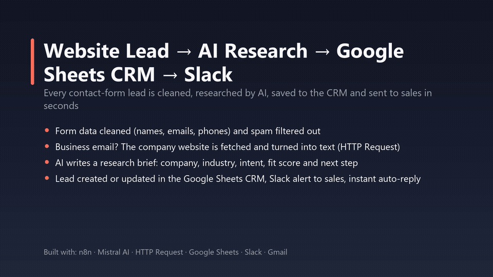
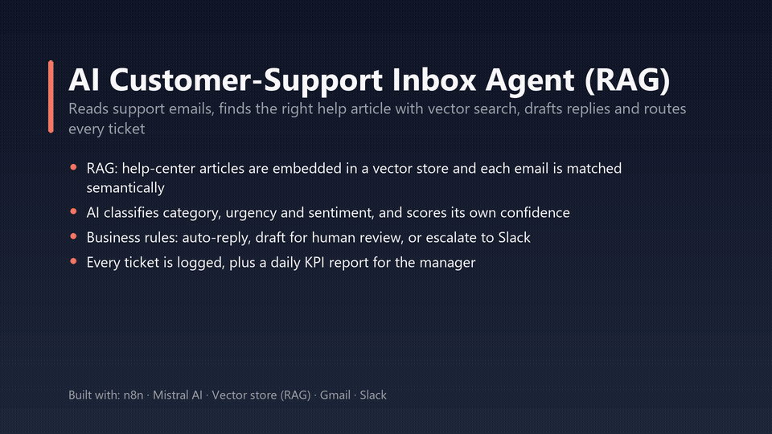
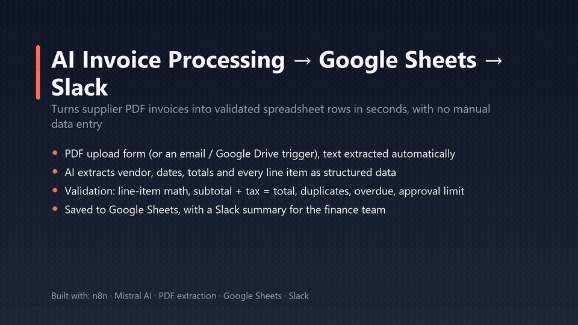
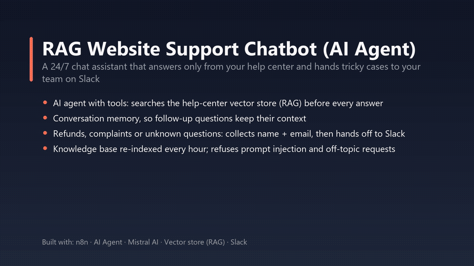

# n8n AI Automation Portfolio

Four production-style **n8n** workflows that combine AI (LLMs, RAG, AI agents) with everyday business tools: Google Sheets, Slack and Gmail.
Every workflow here was built, tested node by node, and run end to end on n8n Cloud. The GIFs below are captured from real, all-green runs.

| # | Workflow | What it shows |
|---|---|---|
| 1 | [Website lead → AI research → Google Sheets CRM → Slack](#1-website-lead--ai-research--google-sheets-crm--slack) | Forms, data cleaning, HTTP Request + web scraping, AI enrichment, CRM upsert |
| 2 | [AI customer-support inbox agent (RAG)](#2-ai-customer-support-inbox-agent-rag) | Vector store, semantic search, AI triage, business-rule routing, KPI reporting |
| 3 | [AI invoice processing → Google Sheets → Slack](#3-ai-invoice-processing--google-sheets--slack) | PDF extraction, structured AI output, validation rules, duplicate detection |
| 4 | [RAG website support chatbot (AI agent)](#4-rag-website-support-chatbot-ai-agent) | AI agent with tools, memory, grounded answers, human handoff |

> These are **sample projects** built to demonstrate the techniques. They aren't client deliverables. The AI model is Mistral (free tier); every workflow can swap it for Claude or OpenAI in one node.

---

## 1. Website lead → AI research → Google Sheets CRM → Slack

**Problem:** inbound leads sit unanswered, get entered into the CRM twice, and sales has no context before the first call.

**How it works**
1. A contact form submission comes in (n8n Form Trigger).
2. The data is cleaned (name casing, lowercased email, phone digits) and spam is filtered out.
3. **Business email?** The company website is fetched with HTTP Request, and its HTML is turned into clean text.
4. The **AI writes a research brief**: company, industry, what they want, a 1–5 fit score and a suggested next step. Guardrails replace guesses with "Unknown".
5. The lead is **created or updated** in the Google Sheets CRM, matched on email, so there are no duplicates.
6. Sales gets a 🔥 Slack alert with the brief, and the lead gets an instant auto-reply.

`workflows/1-lead-capture-ai-research-crm.json` · Form Trigger, IF, HTTP Request, Code, Basic LLM Chain + Structured Output Parser, Google Sheets, Slack, Gmail

---

## 2. AI customer-support inbox agent (RAG)

**Problem:** a support team answers hundreds of repetitive emails by hand, and urgent ones get lost.

**How it works**
1. A new email arrives (Gmail Trigger), or click **Test with sample emails**.
2. Help-center articles are embedded into a **vector store**: daily, and on every demo run.
3. **RAG:** each email is semantically matched to the most relevant articles (with a score threshold plus a relative-gap filter) and to the customer's CRM record.
4. The **AI** classifies category, urgency and sentiment, scores its own confidence, and drafts a reply grounded only in the retrieved articles.
5. **Business rules:** simple, confident answers are auto-sent; unsure ones are saved as drafts; refunds, angry or enterprise customers are escalated to Slack.
6. Every ticket is logged, and the manager gets a **daily KPI report** in Slack.

`workflows/2-ai-support-inbox-agent.json` · Gmail Trigger, Simple Vector Store, Mistral Embeddings, Default Data Loader, Data Tables, Basic LLM Chain, Switch, Gmail, Slack, Schedule Trigger

---

## 3. AI invoice processing → Google Sheets → Slack

**Problem:** finance types supplier PDF invoices into a spreadsheet by hand. It's slow and error-prone, and duplicates slip through.

**How it works**
1. An invoice PDF is uploaded through a form, or click **Test with sample invoice** (a sample PDF is embedded in the workflow).
2. The text is extracted from the PDF.
3. The **AI extracts** vendor, invoice number, dates, currency, totals and every line item as structured JSON.
4. The sheet is checked for a **duplicate** invoice number.
5. **Validation rules:** line items must add up to the subtotal, subtotal + tax must equal the total, and qty × price must equal each amount; overdue invoices are flagged too.
6. A status is set: ✅ Ready to pay · ✋ Needs approval (over €2,000) · ⚠️ Needs review (any failed check).
7. The invoice and its line items are saved to Google Sheets, and finance gets a Slack summary.

`workflows/3-ai-invoice-processing.json` · Form Trigger (file upload), Convert to File, Extract From File (PDF), Basic LLM Chain + Structured Output Parser, Google Sheets, Code, Slack

---

## 4. RAG website support chatbot (AI agent)

**Problem:** customers want instant answers 24/7, but a generic chatbot makes things up.

**How it works**
1. A visitor chats through n8n's hosted chat page or the embeddable widget.
2. The **AI agent** searches the help-center vector store (a tool call) before answering, and replies only with those facts.
3. **Conversation memory** keeps context across messages.
4. For refunds, complaints or questions it can't answer, it asks for the customer's name and email, then calls the **Hand off to a human** tool (Slack).
5. The knowledge base is re-indexed **every hour**. The bot refuses off-topic requests and prompt injection.

`workflows/4-rag-website-support-chatbot.json` · Chat Trigger, AI Agent, Mistral Chat Model, Window Buffer Memory, Simple Vector Store (retrieve-as-tool), Slack Tool, Schedule Trigger

---

## Run them yourself

1. **Import:** in n8n, create a workflow, open the **⋯** menu → **Import from file**, and choose a JSON from `workflows/`.
2. **Credentials:** the exports contain no credentials. Create these and select them on the nodes that need them:
   - **Mistral Cloud API** (free key from console.mistral.ai): chat model and embeddings nodes
   - **Google Sheets OAuth2**, **Gmail OAuth2**, **Slack OAuth2**
3. **Google Sheet** (workflows 1 & 3): create a spreadsheet with the tabs `Leads`, `Invoices` and `Invoice line items`, using the header rows from `sample-data/sheet-*.csv`. Then replace `YOUR_GOOGLE_SHEET_ID` in the Sheets nodes (and in the Slack message link of workflow 3).
4. **n8n Data Tables** (workflows 2 & 4): create `knowledge_base`, `customers` and `support_tickets` from the CSVs in `sample-data/`, then select them in the Data Table nodes (replacing the `YOUR_…_TABLE_ID` placeholders).
5. **Slack channels:** `#sales-leads`, `#support-escalations`, `#support-managers` and `#finance`.
6. **Demo mode:** all outgoing emails go to `you@example.com`. Set your own test inbox there, or switch the *To* field back to the customer's address for production (see the blue "Demo mode" sticky notes).
7. Click **Execute workflow** on the test trigger. Workflows 2 and 4 index the knowledge base first; for workflow 4, click *Refresh knowledge base* once, then **Open chat**.

`sample-data/sample-invoice.pdf` is a realistic invoice you can upload through workflow 3's form.

---

Built by **Lazaros Eleftheriadis**, n8n & AI automation. Open to freelance projects.
